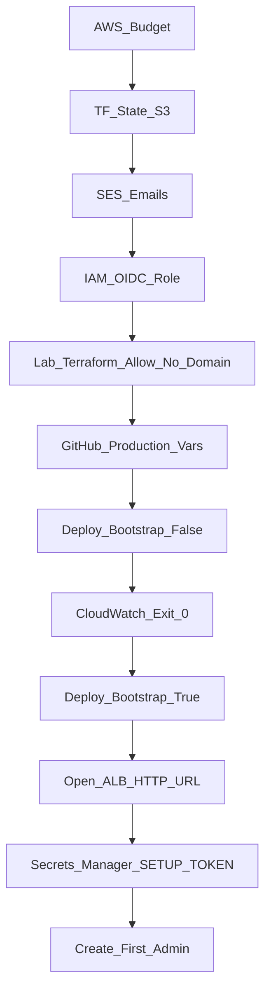

# Helio on AWS — Step-by-Step Teacher Guide (No Domain Needed)

This guide is for you if:

- you have **not** deployed yet, and  
- you **do not own a custom domain**.

You will still put the **entire Helio project on AWS** (all twelve services + workload). You will open the site with the **load balancer HTTP address** AWS gives you (example: `http://helio-xxxx.ap-south-1.elb.amazonaws.com`). HTTPS with your own name like `ops.myproject.com` is optional later (see Part 13).

Follow the parts **in order**. Do not skip Part 1 (budget) or Part 2 (state bucket).

**Region used everywhere:** `ap-south-1` (Mumbai)  
**Deploy method:** GitHub Actions with OIDC (no long-lived AWS access keys in GitHub)  
**Repo assumed:** `anisha0768x/Cloud_native_platform`

Related docs: [deploy/aws/README.md](../deploy/aws/README.md), [`.github/workflows/aws-deploy.yml`](../.github/workflows/aws-deploy.yml).

---

## Big picture (no domain path)



After phase 2, AWS runs:

| Piece | AWS service |
|---|---|
| All 12 Helio apps + workload | ECS Fargate |
| Container images | ECR |
| Public entry (HTTP for this lab) | Application Load Balancer |
| Databases | RDS PostgreSQL Multi-AZ |
| Kafka | ECS Fargate broker (`kafka.helio.internal`) |
| Files and backups | S3 |
| Email | SES |
| Secrets | Secrets Manager |
| Logs | CloudWatch Logs |

**Skipped for now:** Route 53 hosted zone, ACM certificate, custom domain name.

---

## Part 0 — Before you start

### What you need

1. An AWS account with administrator access.
2. GitHub access to the repo (owner/admin) so you can create Environments and run Actions.
3. **One email address** you can open (Gmail is fine) for SES. You can use the same address for both “from” and “to”.
4. Willingness to pay AWS charges while the stack is running.
5. Ability to make **one small lab change** in Terraform (Part 3) so Phase 2 can start without a domain.

### What you do **not** need yet

- A purchased domain  
- Route 53  
- An ACM certificate  
- HTTPS  

### Cost warning (read this)

This stack bills even when nobody opens the website:

- NAT Gateway  
- Multi-AZ RDS  
- Kafka on ECS Fargate (plus NAT, RDS, ALB)  

- Always-on Fargate tasks  

Expect **tens to low hundreds of USD per month** if left on. Tear the stack down when your demo ends (Part 12).

### Golden rule about keys

**Do not** paste `AWS_ACCESS_KEY_ID` / `AWS_SECRET_ACCESS_KEY` into GitHub or into Helio containers for this path.

GitHub Actions **assumes an IAM role** with OIDC. Containers use their **ECS task role** for S3, SES, and ECS. Kafka is PLAINTEXT to `kafka.helio.internal`.

---

## Part 1 — Create an AWS Budget first

**Where:** AWS Console → search **Budgets** → **Billing and Cost Management → Budgets**  
(Billing screens often use `us-east-1`; that is normal.)

### Steps

1. Click **Create budget**.
2. Choose a **Monthly cost budget**.
3. Set a limit you can afford (example: `50` USD).
4. Enter your email for alerts (50% and 100%).
5. Create the budget.

---

## Part 2 — Terraform state S3 bucket

Terraform stores state in a bucket **you create by hand**. It must stay outside the Helio stack so destroying Helio cannot destroy Terraform’s memory.

**Where:** top bar region → **ap-south-1** → **S3** → **Create bucket**.

### Steps

1. **Bucket name:** globally unique, for example `helio-tfstate-<your-account-id>` or `helio-tfstate-<yourname>-2026`.
2. **Region:** `ap-south-1`.
3. **Block Public Access:** leave **all blocks ON**.
4. **Bucket Versioning:** **Enable**.
5. **Default encryption:** Enable (SSE-S3 is fine).
6. Create the bucket.

### What to copy

Exact bucket name → later GitHub variable **`TF_STATE_BUCKET`**.

Do not upload files yourself. Terraform will write `helio/production.tfstate`.

---

## Part 3 — Lab Terraform change (required without a domain)

The stock Terraform **refuses** to start app services unless `domain_name` and `certificate_arn` are set. Without a domain you must relax that check for a student/lab deploy.

**Where on your PC:** open  
[`deploy/aws/main.tf`](../deploy/aws/main.tf)

Find this block near the top:

```hcl
check "production_inputs" {
  assert {
    condition     = !var.bootstrap_complete || (var.domain_name != "" && var.certificate_arn != "")
    error_message = "domain_name and certificate_arn are required before application services are enabled."
  }
  assert {
    condition     = !var.bootstrap_complete || (var.ses_from != "" && var.ses_to != "")
    error_message = "ses_from and ses_to are required before application services are enabled."
  }
}
```

### Change only the first assert

Replace the **first** `condition` line with:

```hcl
    condition     = !var.bootstrap_complete || true
```

Or delete that first `assert { ... }` block entirely, and **keep** the SES assert (emails are still required).

### Why

With an empty certificate, the stack already supports HTTP on the ALB (see load balancer rules in `main.tf`). The check was a safety gate for “production HTTPS.” For your no-domain lab, relaxing it is required so Phase 2 can start all services.

### Push the change

Commit and push this lab change to the branch you will deploy from (usually `main`) **before** Phase 2. Phase 1 can run before or after; Phase 2 must see this commit.

**Teacher note:** When you later buy a domain, put the original assert back and fill domain + ACM vars.

---

## Part 4 — Amazon SES email identities (still required)

Even without a domain, Phase 2 still requires verified SES from/to emails.

**Where:** region **ap-south-1** → **Amazon SES** → **Identities** → **Create identity**.

### Steps

1. Identity type: **Email address**.
2. Enter your Gmail (or other inbox) → Create.
3. Open the email and click the AWS verification link.
4. Status must become **Verified**.
5. For learning, use **the same verified address** for both from and to.

### Sandbox note

New accounts are in the SES **sandbox**: you can only send to verified addresses. That is enough for your own demo inbox.

### What to copy

| Value | GitHub variable later |
|---|---|
| Your verified email | `AWS_SES_FROM` |
| Same (or second verified) email | `AWS_SES_TO` |

---

## Part 5 — GitHub OIDC provider and deploy role

**Where:** AWS Console → **IAM** (IAM is global).

### 5.1 Add GitHub OIDC provider (once per account)

1. IAM → **Identity providers** → **Add provider**.
2. Type: **OpenID Connect**.
3. Provider URL: `https://token.actions.githubusercontent.com`
4. Audience: `sts.amazonaws.com`
5. Add provider.

Skip if it already exists.

### 5.2 Create the deploy role

1. IAM → **Roles** → **Create role**.
2. Trusted entity: **Web identity**.
3. Identity provider: `token.actions.githubusercontent.com`
4. Audience: `sts.amazonaws.com`
5. Create the role (name example: `helio-github-deploy`).

### 5.3 Trust policy (limit to your repo)

Edit the role trust policy so only your repo’s `production` environment can assume it. Replace `YOUR_ACCOUNT_ID` with your account id:

```json
{
  "Version": "2012-10-17",
  "Statement": [
    {
      "Effect": "Allow",
      "Principal": {
        "Federated": "arn:aws:iam::YOUR_ACCOUNT_ID:oidc-provider/token.actions.githubusercontent.com"
      },
      "Action": "sts:AssumeRoleWithWebIdentity",
      "Condition": {
        "StringEquals": {
          "token.actions.githubusercontent.com:aud": "sts.amazonaws.com"
        },
        "StringLike": {
          "token.actions.githubusercontent.com:sub": [
            "repo:anisha0768x/Cloud_native_platform:*",
            "repo:anisha0768x@197058443/Cloud_native_platform@1406097231:*"
          ]
        }
      }
    }
  ]
}
```

### 5.4 Permissions (lab default)

Attach managed policy **AdministratorAccess** to this role so Terraform can create VPC, ECS, RDS, S3, IAM, and related resources on the first try.

### What to copy

Role **ARN** → GitHub **`AWS_DEPLOY_ROLE_ARN`**  
Example: `arn:aws:iam::123456789012:role/helio-github-deploy`

---

## Part 6 — GitHub repository variables (no Environments needed)

If **Settings** shows *“You don't have access to repository options”* and you have no **Environments** link, you are not a repo admin. That is OK for this lab.

Use **repository Variables** instead (you already have this menu):

**Where:**  
Repo → **Settings** → left sidebar **Secrets and variables** → **Actions** → tab **Variables** → **New repository variable**

Direct-ish path: Settings → Secrets and variables → **Actions** → **Variables**.

### Add these repository variables

| Name | What to paste (no domain lab) | Where it came from |
|---|---|---|
| `AWS_DEPLOY_ROLE_ARN` | IAM role ARN | Part 5 |
| `AWS_REGION` | `ap-south-1` | Fixed |
| `AWS_STACK_NAME` | `helio-production` (or another unique prefix) | You choose |
| `TF_STATE_BUCKET` | state bucket name only | Part 2 |
| `AWS_DOMAIN_NAME` | leave empty if allowed, or omit | No domain |
| `AWS_CERTIFICATE_ARN` | leave empty if allowed, or omit | No ACM |
| `AWS_ROUTE53_ZONE_ID` | leave empty if allowed, or omit | No Route 53 |
| `AWS_SES_FROM` | verified email | Part 4 |
| `AWS_SES_TO` | verified email | Part 4 |

Also add `AWS_SES_FROM` and `AWS_SES_TO` the same way (this is how “from” and “to” are set).

### Update IAM OIDC trust (important)

Because deploy no longer uses GitHub Environment `production`, the IAM role trust `sub` must allow the branch, not `environment:production`.

In AWS IAM → role `helio-github-deploy` → Trust relationships, GitHub now sends an **immutable** subject (`owner@id/repo@id`). A name-only `sub` will fail with `Not authorized to perform sts:AssumeRoleWithWebIdentity`.

Use:

```json
"token.actions.githubusercontent.com:sub": [
  "repo:anisha0768x/Cloud_native_platform:*",
  "repo:anisha0768x@197058443/Cloud_native_platform@1406097231:*"
]
```

This account’s IDs (from CloudTrail on a failed assume): owner `197058443`, repo `1406097231`.

### Do **not** paste into GitHub

- AWS access keys  
- Setup token (comes later from Secrets Manager)  
- Database passwords  

### If you later get Admin access

You may create Environment `production` again; the workflow currently reads **repository** `vars.*` and does not require an Environment.

---

## Part 7 — Phase 1 deploy (`bootstrap_complete = false`)

Creates infrastructure, pushes images to ECR, runs the **bootstrap** task (databases + topics). Does **not** start the twelve app services yet.

**Where:** GitHub → **Actions** → **`aws-production-deploy`** → **Run workflow**.

### Inputs

| Input | Value |
|---|---|
| Branch | branch that has your lab Terraform change (after Part 3 push) |
| `confirm` | type exactly `DEPLOY` |
| `bootstrap_complete` | **false** |

Approve the `production` environment if asked.

### Where to watch

1. GitHub Actions job log.  
2. AWS → **ap-south-1** → **CloudWatch** → Log groups → `/ecs/<AWS_STACK_NAME>/bootstrap`  
   Example: `/ecs/helio-production/bootstrap`  
3. **ECS** → Clusters → Tasks (bootstrap task).

### Success rule

Bootstrap task **exit code = 0**.  
Do not start Phase 2 until this is true.

---

## Part 8 — Phase 2 deploy (`bootstrap_complete = true`)

Starts all Helio ECS services.

**Prerequisite:** Part 3 lab Terraform change is on the commit you deploy, SES vars are set, Phase 1 bootstrap exited 0.

**Where:** GitHub → Actions → **`aws-production-deploy`** → **Run workflow** again.

### Inputs

| Input | Value |
|---|---|
| Same commit as Phase 1 images | important (image tag = git SHA) |
| `confirm` | `DEPLOY` |
| `bootstrap_complete` | **true** |

### Where to find your site URL (no domain)

1. AWS → **ap-south-1** → **EC2** → **Load Balancers**.
2. Select the Helio ALB created by the stack.
3. Copy **DNS name**.
4. Open in browser:  
   `http://<that-dns-name>`  
   Example: `http://helio-production-123456.ap-south-1.elb.amazonaws.com`

Also check the workflow / Terraform output `gateway_url` (it will be `http://...` when certificate is empty).

**Note:** Browsers may warn that the site is HTTP not HTTPS. For a private lab demo that is expected until you add a domain + ACM (Part 13).

---

## Part 9 — First administrator setup token

**Where:** AWS → **ap-south-1** → **Secrets Manager** → Secrets.

### Steps

1. Open secret named like **`helio-production/auth`** (`<AWS_STACK_NAME>/auth`).
2. **Retrieve secret value**.
3. Copy JSON field **`SETUP_TOKEN`**.
4. Open your ALB URL from Part 8.
5. Create the first admin: name, email, password (12+ chars), paste setup token.
6. Submit.

Do not commit the token or put it in public screenshots.

---

## Part 10 — Smoke checks

On the ALB HTTP URL:

| Check | Action |
|---|---|
| Login | Sign in as admin |
| Command center | Open overview |
| Capacity | Scale workload 1 → 2 |
| Notifications | Send a notice; check your SES inbox |
| Storage | Upload a small file |
| Backup | Create backup as admin |

### Console map (`ap-south-1`)

| Concern | Where |
|---|---|
| Services | **ECS** → Clusters → Services |
| Images | **ECR** → Repositories |
| Database | **RDS** → Databases |
| Kafka | **ECS** → cluster `helio-production` → service `helio-production-kafka` |
| Files | **S3** (app bucket, not tfstate) |
| Email | **SES** |
| Secrets | **Secrets Manager** |
| Logs | **CloudWatch** → `/ecs/<stack>/...` |
| Public URL | **EC2** → Load Balancers → DNS name |

---

## Part 11 — Cheat sheet (no domain)

| You created | Paste into |
|---|---|
| IAM deploy role ARN | GitHub `AWS_DEPLOY_ROLE_ARN` |
| `ap-south-1` | GitHub `AWS_REGION` |
| Stack prefix | GitHub `AWS_STACK_NAME` |
| State bucket name | GitHub `TF_STATE_BUCKET` |
| *(empty)* | GitHub `AWS_DOMAIN_NAME` |
| *(empty)* | GitHub `AWS_CERTIFICATE_ARN` |
| *(empty)* | GitHub `AWS_ROUTE53_ZONE_ID` |
| SES email | GitHub `AWS_SES_FROM` and `AWS_SES_TO` |
| Secrets Manager `SETUP_TOKEN` | Browser setup form only |
| ALB DNS name | Browser address bar as `http://...` |

---

## Part 12 — Stop billing when finished

1. Destroy the Terraform stack using the same state bucket / role that created it (after disabling RDS deletion protection if destroy is blocked).
2. Confirm ECS (including Kafka), ALB, NAT, RDS, and app S3 resources are gone.
3. Keep the state bucket until destroy succeeds; then you may delete it.
4. Until destroy finishes, assume you are still being billed.

---

## Part 13 — Optional later: add a real domain + HTTPS

Do this only when you buy a domain. Then:

1. Restore the original Terraform domain/certificate assert in `deploy/aws/main.tf`.
2. Create a Route 53 hosted zone (or use one you have).
3. Request an ACM certificate in **`ap-south-1`** for your hostname; validate with DNS; wait until **Issued**.
4. Set GitHub vars:
   - `AWS_DOMAIN_NAME` = `ops.yourdomain.com`
   - `AWS_CERTIFICATE_ARN` = certificate ARN
   - `AWS_ROUTE53_ZONE_ID` = hosted zone ID
5. Re-run the deploy workflow with `bootstrap_complete=true` (and `DEPLOY`).
6. Open `https://ops.yourdomain.com` instead of the raw ALB HTTP URL.

---

## Two-phase reminder

| Phase | `bootstrap_complete` | Result |
|---|---|---|
| 1 | `false` | Infra + images + DB/topic bootstrap |
| 2 | `true` | All Helio services start; open ALB HTTP URL |

---

## If something fails

| Symptom | Check |
|---|---|
| Cannot assume role | OIDC trust `sub` repo/environment; wrong role ARN |
| Backend init error | Wrong `TF_STATE_BUCKET` / region |
| Phase 2 still demands domain | Part 3 lab change not pushed / wrong commit |
| Phase 2 demands SES | Verify emails; set `AWS_SES_FROM` / `AWS_SES_TO` |
| Bootstrap non-zero | CloudWatch `/ecs/<stack>/bootstrap` |
| No idea what URL to open | EC2 → Load Balancers → DNS name → `http://...` |
| Email missing | SES sandbox; send only to verified address |

---

## What success looks like (your situation)

1. Budget alert exists.  
2. State bucket exists and is private.  
3. SES email verified.  
4. Lab Terraform domain check relaxed and pushed.  
5. GitHub `production` vars set (domain/cert/zone empty).  
6. Phase 1 green; bootstrap exit `0`.  
7. Phase 2 green; ECS services stable.  
8. You open **`http://<ALB-DNS>`** and create the first admin with `SETUP_TOKEN`.  
9. You know how to destroy the stack to stop billing.

You do **not** need a domain to complete a full AWS integration of this project for a lab or faculty demo.
